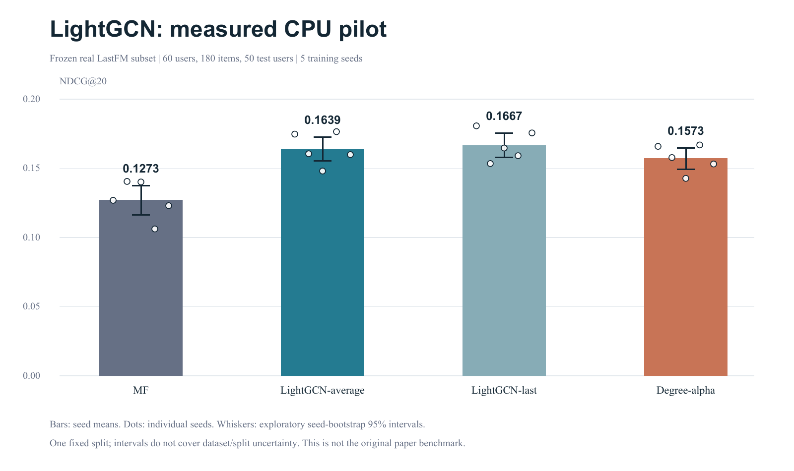

# LightGCN：从论文到负结果与下一步

案例日期：2026-10-14，Asia/Shanghai。此页只分享公开来源、自写实现与聚合结果，不附用户原PDF、原数据或完整本地状态。

## 实际做过的工作

| 阶段 | 操作及结果 |
|---|---|
| 环境/输入 | 核Python/pypdf/NumPy与实际torch导入；导入用户ACM版本11页（含封面），FTS词法定位；检查关键公式、图1–5及表格 |
| 精读 | 来源、PaperCard、定位Claims；理解ID-only线性归一化传播、包括E0的层融合、BPR；Table3的0.530与同文Table4的0.0530冲突保留为疑似排印异常 |
| 调研 | 4批15条真实查询，五核心原文比较及近期摘要筛查；实际Crossref元数据查询、arXiv全文获取 |
| 查新/设计 | 找到学习alpha、CL、度数分组的直接先例；三个候选、两可证伪假设，收缩为机制复核 |
| 仓库 | 下载作者链接的PyTorch代码，固定commit/clean状态，9处论文—代码映射；发现论文Xavier与活跃代码normal.1初始化差异 |
| 实验 | 自写NumPy核心实现，真实LastFM小图，数学/指标检查、smoke、五seed pilot；约8.857秒脚本计算，实际日志/输入输出hash |
| 分析 | 20行逐seed、1000行逐用户，四份直接关联真实run产物的统计；按训练seed聚合、配对差异与Bootstrap |
| 评审/决定 | 两个真实独立智能体分别做文献与实验审查；主智能体核证据并单一写正式库；保留负结果和失败修正 |
| 恢复 | 修订、引用/产物hash校验、导出；新进程读回负结果和下一步；同completed run再次进入没有重跑 |

## 阅读/查新的判断

[LightGCN 原文](https://arxiv.org/abs/2002.02126)定义对称归一化S与层加权和，默认uniform alpha。它已讨论alpha学习，训练学习没有改善、验证学习提升不足1%，并把个性化用户/物品权重列为后续方向（用户ACM版PDF5 §3.1.2、PDF7 §3.3尾、PDF11未来工作）。均匀融合并非所有数据/层数设置都胜过末层（PDF9 §4.4.1）。这些是作者局部结果，不能推广成全局定理。

“加对比学习”已有 [SGL](https://hexiangnan.github.io/papers/sigir21-SGL.pdf) §3.2–3.3的直接先例；[XSimGCL](https://arxiv.org/pdf/2209.02544) §3.2覆盖噪声与跨层CL；[NGCF](https://arxiv.org/pdf/1905.08108) §4.3.2已按用户稀疏度分组；[LayerGCN](https://arxiv.org/pdf/2207.11088) §III.B已有节点层精炼和DegreeDrop。因此撤回宽泛创新主张。

相关四篇只读selected fulltext、未核全部图/理论；搜索窗口2025-10-14至2026-10-14内 [RaDAR](https://arxiv.org/abs/2603.16800)仅筛查摘要。查新是有界的，不声称最新/全面。跨文数据划分、预算和候选协议不同，不拼性能排行榜。

## 小图真实实测

来自作者链接仓库的固定LastFM文件；训练频次选180物品，训练条件选前60数值ID用户，无test驱动的集合选择。训练内留出每用户一个验证正例：389fit/60validation/99test、50test用户。所有训练方法16维、normal.1相同初值、Adam lr.02/lambda1e-4、batch256、180steps、seeds0..4；固定步数而非test选择。

| 方法 | Recall@20均值 | NDCG@20均值 | NDCG种子Bootstrap95%区间 |
|---|---:|---:|---|
| MF | .270200 | .127337 | [.116327,.137634] |
| LightGCN-average | .349133 | .163943 | [.155292,.172594] |
| LightGCN-last | .357800 | .166711 | [.157965,.175456] |
| Degree-alpha | .346333 | .157287 | [.149448,.164667] |

流行度基线一次确定性测量：Recall .122667、NDCG .053259，不制造五次重复。

标准LightGCN−MF的NDCG差+.036606，五seed均正，配对Bootstrap区间[.018322,.054654]；只支持此配置的小图方向信号。Degree-alpha−标准差−.006656，五seed均负，区间[−.008737,−.004472]；按预设反驳规则，该固定规则改善假设不支持。末层均值稍高但seed方向混合，不作一般优越结论。

## 评审发现和最后决策

独立梯度最大误差9.88e-11，指标小例与用户→seed聚合误差0；输入/分析hash与原文件映射一致。保留第一轮smoke的JSON同名描述字段覆盖数组错误：断言停止，改为独立description字段并创建新计划/新run；没有覆盖或删除失败。

限制：sampled-E0正则对齐官方代码习惯，不等同论文全局L2逐字目标；smoke已访问test，记录没有依其调参；29候选物品fit度为0，末层零表示与索引同分排序；负采样可能含未观察正例；一个偏选小图、五训练seed、共享超参不能替代强基线充分调参和多划分。Bootstrap只覆盖条件于本图的训练随机性。

原论文Gowalla/Yelp2018/Amazon-book、64维/lr.001的完整基准尚未复现，官方torch入口也未在本环境运行。下一步需核完整数据版本/许可、修复框架、匹配强基线预算并使用新的预设测试协议；近期机制创新也需补全文与直接竞争比较。

这说明ResearchPilot能够把真实论文变成证据、可执行设计、实际测量、反驳与决定；不会因为需要“创新结果”就抛弃负结果。

公开材料：[自写实现及操作说明](../examples/lightgcn/README.md)、[20行逐seed聚合结果](../examples/lightgcn/results/rows.csv)、[实测摘要](../examples/lightgcn/results/metrics.json)。

